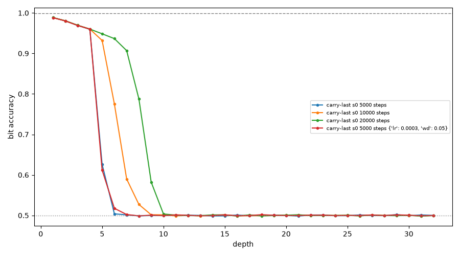

# Rule 30 pilot: gate result (negative)

Paper-faithful carry-last (dim 64, RoPE, AdamW lr 1e-3 wd 0.15, fixed 100k
pool, batch 128, train depth 4, eval depths 1-32 over 4096 rows).
Gate needs d1 >= 0.999 and d4 >= 0.99.

| run | train loss | d1 | d4 | d6 | d9 | d12 |
|---|---|---|---|---|---|---|
| 5k | 0.0417 | 0.98841 | 0.95954 | 0.50385 | 0.49986 | 0.50051 |
| 10k | 0.0376 | 0.98835 | 0.96009 | 0.77504 | 0.49986 | 0.50046 |
| 20k | 0.0374 | 0.98845 | 0.96015 | 0.93653 | 0.50356 | 0.49962 |
| 5k lr 3e-4 wd 0.05 | 0.0384 | 0.98823 | 0.96010 | 0.51747 | 0.49948 | 0.49867 |

Paper reference (carry-last, depth 4): ~0.9997 / ~0.9974 / 0.93 at d4/d6/d9.

## Verdict: GATE FAILED on all four rungs. No arms were run.

d1 is frozen at 0.9882-0.9885 across 4x compute and different
optimisation. This is not undertrained-in-steps: 5k -> 20k changes
nothing in range. The reimplementation does not reach the paper's 0.9997,
so per the pre-registered rule nothing else is interpretable and no arm
ran. A clean negative.

Two observations for the next attempt:
1. The cliff moves right with steps (d6: 0.50 -> 0.78 -> 0.94) while d1/d4
   stay frozen. Longer training extends the chain slightly without fixing
   the single-step error.
2. Successive-state cosine sims (seed 0, 5k weights) collapse fast:
   0.28, 0.61, 0.66, 0.71, 0.88, 0.96, 0.98, 0.99, then 1.0 from depth
   ~20. The loop converges to a fixed point, so late iterations decode
   the same row and accuracy falls to chance. See
   runs/carry-last_s0_cossim.json.

Suspects for the d1 gap (untested): LayerNorm vs RMSNorm, GELU vs ReLU,
init scale, RoPE base or boundary handling. The paper's number may also
depend on an unstated detail.

## What finished / did not

- Finished: gate probe + full ladder (5k, 10k, 20k, lr/wd check),
  cosine-sim extra, this writeup, chart.
- Not finished: all six arm conditions (carry-last s1/s2, full x3, K=2 x3,
  K=1, decayed x3, paper-cache x2). Blocked on the gate per the task's
  stop condition.
- Next step if the d1 gap is closed: rerun the gate, then the sweep in
  task order (~46 min/run, ~11 h for the 3-seed sweep).

